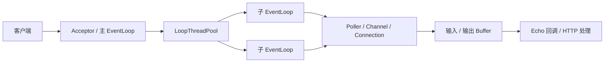

<div align="center">


<h1>Reactor Server</h1>

<p><b>从一个连接，理解服务器的运行方式。</b></p>

<p>  </p>

<p><a href="#功能速览">功能速览</a> · <a href="#架构说明">架构说明</a> · <a href="#快速开始">快速开始</a> · <a href="#当前边界">当前边界</a> · <a href="./README.en.md">English</a></p>

</div>

---

一个基于 **C++11、Linux Socket 和 epoll** 实现的网络服务器学习项目。底层采用多线程 Reactor 模型，封装 TCP 连接、读写缓冲区、事件循环和时间轮定时器；上层提供 TCP Echo 与 HTTP 服务示例。

通过本项目可以了解从 Socket 通信到 HTTP 请求处理的实现过程，以及连接管理、跨线程任务调度和超时回收等网络编程机制。

## 功能速览

<table>
  <tr>
    <td width="33%" valign="top"><b>01 / 连接与事件</b><br /><br />基于 epoll 管理就绪事件，主循环接收连接，子循环处理 I/O。</td>
    <td width="33%" valign="top"><b>02 / 线程与时间</b><br /><br />通过 eventfd 调度跨线程任务，通过 timerfd 和时间轮回收超时连接。</td>
    <td width="33%" valign="top"><b>03 / 从 TCP 到 HTTP</b><br /><br />提供 Echo 示例、HTTP 请求解析、业务路由和静态文件服务。</td>
  </tr>
</table>



> 这是 Linux 网络编程学习项目，提供 TCP Echo 与基础 HTTP 服务示例。HTTP 协议支持范围和连接处理限制详见下文，不包含并发性能基准承诺。

## 功能概览

### TCP 网络层

- **Socket 封装**：提供监听、连接、收发数据及非阻塞设置等接口。
- **读写缓冲区**：通过读写偏移管理数据，支持空间整理、扩容和按行读取。
- **epoll 事件分发**：使用 `Channel` 管理文件描述符及回调，使用 `Poller` 监听就绪事件。
- **多线程 Reactor**：主事件循环负责接收连接，子事件循环按轮询方式分配连接并处理 I/O。
- **跨线程任务调度**：通过任务队列与 `eventfd` 唤醒事件循环，在所属线程中执行操作。
- **时间轮定时器**：使用 `timerfd` 按秒驱动，支持定时任务添加、刷新和取消，以及非活跃连接回收。
- **连接上下文与回调**：支持保存协议上下文，注册连接建立、消息到达和连接关闭等业务回调。

### HTTP 应用层

- 分阶段解析请求行、请求头和基于 `Content-Length` 的请求正文。
- 解析 URL 路径与查询参数，提供 URL 编解码工具。
- 提供 `GET`、`POST`、`PUT`、`DELETE` 路由注册接口，使用正则表达式匹配路径。
- 提供静态文件服务、默认首页和按扩展名设置 MIME 类型的能力。
- 封装响应状态码、响应头、正文和重定向。
- 提供显式 `Connection: keep-alive` 的连接复用机制和默认 10 秒的非活跃连接回收。

## 架构说明

```text
客户端
  │
  ▼
Acceptor / 主 EventLoop
  │ 接收新连接
  ▼
LoopThreadPool
  │ 轮询分配连接
  ├── 子 EventLoop ── Poller / Channel ── Connection
  ├── 子 EventLoop ── Poller / Channel ── Connection
  └── 子 EventLoop ── Poller / Channel ── Connection
                                            │
                                            ▼
                                    输入 / 输出 Buffer
                                            │
                                            ▼
                                  Echo 回调或 HTTP 处理
```

每个 `EventLoop` 都负责事件监听、就绪事件处理和待执行任务，也管理自己的时间轮。HTTP 层在连接上下文中保存解析状态，待请求接收完整后，再分发到静态资源处理逻辑或业务路由。

| 核心组件 | 作用 |
| --- | --- |
| `Buffer` | 管理接收与发送数据的缓冲区 |
| `Socket` | 封装 TCP Socket 操作 |
| `Channel` | 关联文件描述符、监听事件与回调 |
| `Poller` | 封装 epoll 事件监听 |
| `TimerTask` / `TimerWheel` | 管理定时任务与连接超时 |
| `EventLoop` | 驱动事件处理与任务执行 |
| `LoopThread` / `LoopThreadPool` | 管理子事件循环线程及连接分配 |
| `Connection` / `TcpServer` | 管理 TCP 连接生命周期与服务入口 |
| `HttpContext` | 保存 HTTP 请求解析进度 |
| `HttpRequest` / `HttpResponse` / `HttpServer` | 表示请求、构造响应和注册路由 |

## 目录结构

以下列出主要源码与资源文件：

```text
my_server/
├── source/
│   ├── server.hpp              # TCP 网络库与 Reactor 核心实现
│   ├── echo/
│   │   ├── echo.hpp            # Echo 业务回调
│   │   ├── main.cc             # Echo 服务入口
│   │   └── makefile
│   └── http/
│       ├── http.hpp            # HTTP 解析、响应、路由与静态文件服务
│       ├── main.cc             # HTTP 服务入口与示例路由
│       ├── makefile
│       └── wwwroot/
│           ├── index.html     # 表单示例首页
│           └── 1234.txt       # 静态文件与上传示例目标
├── test/
│   ├── client1.cpp ~ client6.cpp
│   ├── hello.txt              # 上传测试数据
│   └── makefile
├── httpv1/                    # Buffer、Any、时间轮和正则解析等独立实验
├── README.md
└── README.en.md
```

主要服务入口位于 `source/`，`httpv1/` 用于查看独立组件实验。仓库中也包含已编译程序，建议在自己的 Linux 环境中重新编译。

## 环境要求

- **Linux**：源码依赖 `epoll`、`eventfd`、`timerfd` 等 Linux 接口。
- **GCC / g++ 与 GNU Make**：主服务的 Makefile 使用 `-std=c++11`，并链接 pthread。
- **现代 libstdc++**：公共头文件包含 `<any>`，需要工具链提供该头文件；网络层实际使用项目自定义的 `Any` 类。
- **curl**：用于 HTTP 示例验证。
- **netcat（可选）**：用于 Echo 示例验证。

Windows 用户需在安装了编译工具的 Linux WSL 发行版、Linux 虚拟机或 Linux 容器中执行下面的命令。

## 快速开始

### 1. 获取代码

```bash
git clone https://github.com/HandlerOne01/my_server.git
cd my_server
```

### 2. 编译并启动 HTTP 服务

在仓库根目录执行：

```bash
cd source/http
make -B
./main
```

`-B` 强制重新编译，避免直接使用仓库中已有的可执行文件。当前 HTTP 示例默认配置如下：

| 配置项 | 默认值 | 配置位置 |
| --- | --- | --- |
| 监听地址 | `0.0.0.0` | `source/server.hpp` 中的 `Socket::CreateServer` |
| 监听端口 | `8085` | `source/http/main.cc` |
| 子事件循环线程数 | `3` | `source/http/main.cc` |
| 静态资源目录 | `./wwwroot/` | `source/http/main.cc` 中的 `WWWROOT` |
| 非活跃连接超时 | `10` 秒 | `source/http/http.hpp` 中的 `DEFALT_TIMEOUT` |

请在 `source/http` 目录运行程序，静态资源路径相对于当前工作目录解析。启动后可以访问：

```text
http://127.0.0.1:8085/
```

首页提供一个提交到 `/login` 的表单。使用 `Ctrl+C` 停止服务。

### 3. 验证 HTTP 接口

保持 HTTP 服务运行，在另一个终端执行：

```bash
# 获取首页
curl -i http://127.0.0.1:8085/

# GET：回显请求信息与查询参数
curl -i 'http://127.0.0.1:8085/hello?name=demo'

# POST：回显表单请求
curl -i --data 'username=demo&password=example' \
  http://127.0.0.1:8085/login

# 获取静态文本文件
curl -i http://127.0.0.1:8085/1234.txt

# 请求不存在的资源，查看 404 状态
curl -i http://127.0.0.1:8085/not-found
```

当前示例接口的实际行为：

| 方法 | 路径 | 行为 |
| --- | --- | --- |
| `GET` | `/` | 返回 `wwwroot/index.html` |
| `GET` | `/hello` | 回显请求方法、路径、协议版本、查询参数、请求头与正文 |
| `POST` | `/login` | 回显请求信息，不执行账号认证 |
| `GET` | `/1234.txt` | 返回静态文本文件 |
| `PUT` | `/1234.txt` | 将请求正文写入 `wwwroot/1234.txt`，覆盖原内容 |
| `DELETE` | `/1234.txt` | 回显请求信息，不执行文件删除 |

上传示例会覆盖 `wwwroot/1234.txt`，请先备份需要保留的内容：

```bash
curl -i -X PUT --data-binary 'hello from my_server' \
  http://127.0.0.1:8085/1234.txt

curl -i http://127.0.0.1:8085/1234.txt
```

### 4. 编译并启动 Echo 服务

先停止 HTTP 服务，再从仓库根目录执行：

```bash
cd source/echo
make -B
./main
```

Echo 示例同样监听 `8085` 端口，配置了 2 个子事件循环线程和 10 秒非活跃超时。收到数据后会回显，并在待发送数据处理完后关闭连接。

在另一个终端中使用 netcat 验证：

```bash
printf 'hello my_server\n' | nc 127.0.0.1 8085
```

HTTP 与 Echo 示例默认使用相同端口，单独运行每个示例进行验证；如需同时使用，请先修改其中一个服务的端口。

## 添加业务路由

在 `source/http/main.cc` 中，按照现有接口注册回调，并放在 `server.Listen()` 之前：

```cpp
server.Get("/ping", [](const HttpRequest &req, HttpResponse *rsp) {
    rsp->SetContent("pong", "text/plain");
});
```

重新编译并启动后，可以请求：

```bash
curl -i http://127.0.0.1:8085/ping
```

路由采用 `std::regex_match` 进行完整路径匹配，并按注册顺序查找。`GET` 请求优先尝试静态文件处理，因此业务路径应避免与已有静态文件重名。查询参数通过 `req.GetParam("参数名")` 获取，请求正文通过 `req._body` 获取；正文的 JSON 或表单解析需要在业务回调中实现。

## 测试客户端

`test/` 提供手动运行的场景测试客户端，默认连接 `127.0.0.1:8085`。运行前应先启动 **HTTP 服务**。

| 客户端 | 主要场景 |
| --- | --- |
| `client1` | 每 3 秒发送请求，观察长连接与活跃度刷新 |
| `client2` | 请求间隔 15 秒，观察默认 10 秒超时后的连接行为 |
| `client3` | 携带正文并连续发送请求，观察正文接收与请求边界处理 |
| `client4` | 创建 10 个子进程持续请求，观察多客户端处理；业务处理超时场景需另行加入慢回调 |
| `client5` | 一次发送 3 条 HTTP 请求，观察连续请求处理 |
| `client6` | 上传 `hello.txt`，观察正文传输与文件保存 |

从仓库根目录进入测试目录，按需编译运行：

```bash
cd test
make -B client1
./client1
```

`make -B` 默认只构建 `client6`；使用 `make -B client2` 等命令选择其他客户端。多数客户端会循环运行，或在预期断连后触发断言，需结合服务日志判断结果。

`client6` 会覆盖 HTTP 服务的 `wwwroot/1234.txt`，且使用 `Connection: keep-alive`。当前上传响应正文为空，没有显式的 `Content-Length: 0`；观察客户端输出时应同时核对文件内容，不能仅以客户端结束或输出作为上传成功的依据。

## 当前边界

本项目侧重网络编程机制的学习与实现，使用时应了解当前代码的边界：

- HTTP 解析面向基础 HTTP/1.0、HTTP/1.1 请求，正文按 `Content-Length` 接收，未实现 chunked 编码、HTTPS 或 HTTP/2。
- 当前请求头使用区分大小写的键查找，头部解析要求 `Key: Value` 格式；长连接需要显式发送 `Connection: keep-alive`。
- `HEAD` 复用 GET 的处理路径，响应生成尚未单独省略正文，不能视为完整的 HEAD 支持。
- `SetContent` 与响应生成逻辑使用的 Content-Type 键名大小写不同，动态响应可能出现重复 Content-Type 字段。
- 空正文响应没有统一补充 `Content-Length: 0`，长连接下的响应边界处理仍需完善。
- 文件读取、写入和业务回调在事件循环线程中同步执行，耗时业务会影响同一事件循环内其他连接的处理。
- 当前时间轮为 60 个槽、每秒推进一格，长延时任务需要进一步扩展或限制参数，不能直接按任意时长使用。
- 仓库提供场景测试源码，但未提供统一自动化测试入口或并发性能基准数据。

## 常见问题

**编译时找不到 `sys/epoll.h` 等头文件**

请确认在 Linux 环境编译；项目依赖 Linux 专用系统接口，不能直接使用 Windows 原生工具链构建。

**编译时找不到 `<any>`，或实验中的 `std::any` 不可用**

请使用提供 `<any>` 头文件的现代 GCC/libstdc++。主服务使用自定义 `Any`，而 `httpv1/any.cpp` 使用标准库 `std::any`，该实验需要以 C++17 编译。

**启动时报端口绑定失败**

检查 `8085` 是否被其他进程占用，并确认正在运行的是所需服务。端口可在各示例的 `main.cc` 中修改。

**启动时静态目录断言失败，或页面资源无法访问**

HTTP 服务使用相对路径 `./wwwroot/`。请进入 `source/http` 后运行 `./main`，或将 `WWWROOT` 改为实际存在的资源目录。

## 参与贡献

欢迎围绕协议解析、连接生命周期、异常处理和场景测试提出 Issue 或 Pull Request。提交修改时，请说明问题的复现方式、变更内容及实际验证结果。

## 许可证

当前仓库未提供 LICENSE 文件，具体使用和分发授权请与仓库作者确认。

## 相关项目

| 项目 | 这里负责什么 |
| --- | --- |
| [IMiss Blog](https://github.com/HandlerOne01/IMiss_Blog) | Astro + Svelte 个人技术博客，提供文章阅读与 AI 桌宠入口。 |
| [Agent for Blog](https://github.com/HandlerOne01/agent_-for_-blog) | LangGraph 博客助手，负责文章推荐、正文介绍与阅读偏好。 |
| [Boost Search Engine](https://github.com/HandlerOne01/search_engine) | C++ 文档搜索实践，学习分词、索引与结果排序。 |
| [Reactor Server](https://github.com/HandlerOne01/my_server) | C++ Linux 网络编程实践，学习连接、事件循环与 HTTP。 |

<p align="center"><sub>记录学习，也把每一次实践留成可以回看的路。</sub></p>
